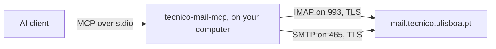

# Técnico Mail MCP

Connect your own Técnico mailbox to Claude and other AI clients. It runs on your computer.

`v1.0.0`

**Unofficial. Not affiliated with IST or DSI.**

### [Download for Claude Desktop](https://github.com/FL-spec/tecnico-mail-mcp/releases/latest/download/tecnico-mail.mcpb)

[Install](#install) · [Is your password safe?](#is-your-password-safe) · [Tools](#tools) · [Other clients](docs/clients.md) · [Troubleshooting](docs/troubleshooting.md)

The picture shows real tool calls and results on fictional mail, recorded by
[`scripts/demo/record.mjs`](scripts/demo/record.mjs). Ask your AI client what your professors sent
you this week, and it reads your mail through these tools.

## Install

You need [Claude Desktop](https://claude.ai/download). Nothing else.

1. [Download `tecnico-mail.mcpb`](https://github.com/FL-spec/tecnico-mail-mcp/releases/latest/download/tecnico-mail.mcpb)
   and double-click it.
2. Fill in your Técnico ID (`istxxxxx`), your password, and your Técnico email address.
3. Start a new chat and ask about your mail.

Claude Code, Cursor, VS Code, and other clients install it with one command. See
[other clients](docs/clients.md).

## Is your password safe?

Your password stays on your computer and goes to `mail.tecnico.ulisboa.pt` and nowhere else.

| Question | Answer |
| --- | --- |
| Where is it stored? | In your OS keychain, by Claude Desktop or by the `login` command. |
| Where does it go? | Only to `mail.tecnico.ulisboa.pt`, over TLS with a verified certificate. |
| Is there a server in the middle? | No. There is no hosted service and no telemetry. |
| Can you read the code? | Yes. It's about 2,300 lines of TypeScript in [`src/`](src), all open source. |
| Can you check the download? | Yes. CI builds every release and signs its provenance. See [verifying a release](SECURITY.md#verify-a-release). |

**Your mail does leave your computer in one way.** Whatever the AI reads goes to the provider
behind your client, such as Anthropic for Claude, like anything else in a chat. Think twice before
asking it about confidential mail.

**Your password also opens Fénix.** That's the reason this project has no hosted version. Read the
full [security model](SECURITY.md) before you use it.

## Tools

By default, Claude can read mail, save drafts, and organize messages, but it **can't send
anything**. An email can contain text written to trick an AI, so sending is off until you turn it
on.

| Tool | What it does | `read-only` | default | `allow-send` |
| --- | --- | --- | --- | --- |
| `list_folders` | Folders with unread counts | yes | yes | yes |
| `search_messages` | Search by sender, subject, text, date, or unread state | yes | yes | yes |
| `get_message` | A message as clean text, with its attachment list | yes | yes | yes |
| `get_attachment` | The text of a PDF, DOCX, or plain text attachment | yes | yes | yes |
| `create_draft` | Save a draft for you to review, including threaded replies | | yes | yes |
| `mark_read` | Mark as read or unread | | yes | yes |
| `flag` | Flag or unflag | | yes | yes |
| `move_message` | Move to a folder or to Trash | | yes | yes |
| `send_message` | Send a message and keep a copy in Sent | | | yes |
| `reply` | Send a threaded reply and keep a copy in Sent | | | yes |

Reading never marks mail as read. There's no permanent delete. Results are capped, so a search
can't fill the AI's context. The [tool reference](docs/tools.md) has every option and limit.

Choose the access mode in the extension's settings, or with `--read-only` or `--allow-send` on the
command line.

## How it works

Your AI client starts the server as a local process and talks to it over stdio. The server talks to
Técnico's mail server the same way Thunderbird does, using the settings
[DSI publishes](https://si.tecnico.ulisboa.pt/?p=79). See [how it works](docs/how-it-works.md).

## Limitations

- **CI can't run against a real Técnico mailbox.** It tests every tool against Dovecot 2.4.1, the
  server software Técnico runs, and a local SMTP server. See
  [what's tested](docs/how-it-works.md#testing).
- It stops working if Técnico adds multi-factor login to mail or blocks password access. It would
  show a clear login error.
- It can't read scanned PDFs, because they hold images, or send attachments.
- A wrong password stops login attempts until you restart the server, so it can't lock your account.

## Contributing

Bug reports and pull requests are welcome. See [CONTRIBUTING.md](CONTRIBUTING.md) and the
[code of conduct](.github/CODE_OF_CONDUCT.md). Report security problems privately, as
[SECURITY.md](SECURITY.md) explains.

## License and disclaimer

[MIT](LICENSE). This is an independent student project. It's not affiliated with, endorsed by, or
supported by Instituto Superior Técnico or its IT services (DSI). "Técnico" names the institution
whose public mail service the tool connects to. Don't ask DSI for support with this tool.

---

v1.0.0. Release history is in the <a href="CHANGELOG.md">changelog</a>.

