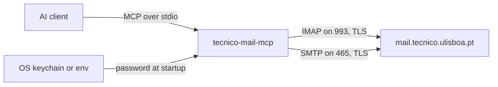

# Architecture

This describes the system as built. Where it and the code disagree, the code wins.

## System overview

The client launches the server as a subprocess and talks to it over stdio. The server keeps one
IMAP connection and opens an SMTP connection only to send.

## Module boundaries

| Module | Owns | Spec |
| --- | --- | --- |
| `src/` | tools, access modes, IMAP session, parsing, composing, command line | `specs/server.md` |

## Cross-cutting concerns

- **Secrets.** Only `src/config.ts` and `src/credentials.ts` read the password. It goes to the
  session and to the SMTP sender. No code logs it or puts it in an error.
- **Logging.** stderr only, with metadata only. Stdout carries the protocol.
- **Errors.** Every failure a user can see is a `MailError` with a cause and a next step.
- **Untrusted content.** Mail is hostile input. HTML is converted to text with hidden elements
  removed, invisible Unicode is stripped, and attachments are never written to disk.

## Decisions

- [2026-11-05—Run locally, never hosted](decisions/2026-11-05-local-only.md)
- [2026-11-05—TypeScript with a Desktop Extension as the main install](decisions/2026-11-05-typescript-and-mcpb.md)
- [2026-11-05—Optional keychain login for npx users](decisions/2026-11-05-optional-keychain-login.md)
- [2026-09-07—Single entry point and two delivery lanes](decisions/2026-09-07-single-entry-two-lanes.md)

## Open Questions

- _(none yet)_
